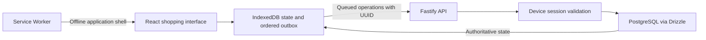
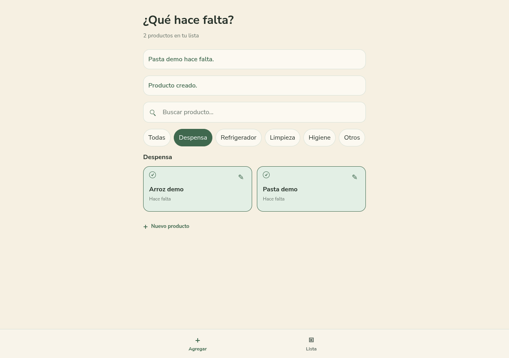
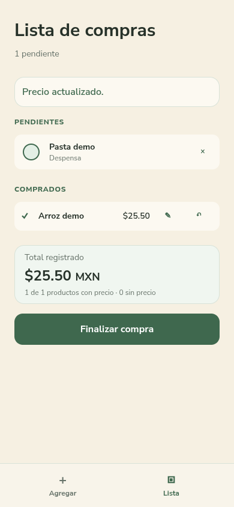

# Offline Shopping List

A mobile-first grocery PWA that keeps shopping actions available when the connection drops.

## Problem and implemented scope

A household shopping list needs to remain useful inside a store with unreliable connectivity. This application lets an authorized device keep a local shopping state, queue changes offline, and synchronize them when the server is reachable again.

The implementation currently includes:

- A categorized product catalog with search, creation, editing and deactivation.
- A pending list and one active purchase, with bought/pending states, undo and purchase completion.
- Optional prices stored as integer cents in MXN; totals distinguish items with and without a price.
- IndexedDB persistence and an ordered outbox for list and purchase actions.
- UUID-based mutation idempotency: retries with the same operation return the original result; conflicting reuse is rejected.
- Device pairing with a temporary single-use code, revocable sessions and an HttpOnly/Secure/SameSite cookie.
- PWA manifest metadata, offline navigation after initial setup, and guarded Service Worker updates.

Catalog creation, editing and deactivation require a connection. Offline availability covers shopping-list and purchase actions after the application has been loaded and the device linked.

## Architecture



IndexedDB provides immediate local state. PostgreSQL is authoritative for synchronized data. The Service Worker precaches the application shell and static assets; it does not cache API responses. A 401 stops synchronization and leaves queued changes intact. Definitive rejected operations are retained for diagnosis instead of silently retried forever.

The app currently serves one shared household dataset. Device authorization does not create separate tenants or per-device shopping lists.

## Technologies

| Area | Technologies |
| --- | --- |
| Frontend | TypeScript, React, Vite, Tailwind CSS |
| Local persistence | IndexedDB, ordered outbox |
| Backend | Node.js, Fastify, Zod |
| Server persistence | PostgreSQL 17, Drizzle ORM and versioned SQL migrations |
| PWA | vite-plugin-pwa and Workbox |
| Verification sources | Vitest, Testing Library and fake-indexeddb |
| Packaging | pnpm workspaces, Docker Compose; optional containerized API/web deployment |

Dependency versions are recorded in `package.json` files and `pnpm-lock.yaml`.

## Local demo with fictional data

These are setup instructions for this sanitized source snapshot. An isolated validation completed on 2026-10-13 using Node.js 26.9.0, pnpm 11.19.0 and disposable PostgreSQL 17.10. See [validation evidence](docs/public/evidence/validation-2026-10-13/README.md); Docker image startup and the minimum Node version were not tested.

Use a separate disposable environment with no production configuration or data. The development scripts listen on network interfaces; use an isolated VM or development network. Do not reuse a production checkout, its `.env`, Docker project or database.

Requirements: Node.js 22+, the pnpm version declared by `packageManager` (11.19.0 in this snapshot), and Docker Compose. The example selects a separate loopback database port and a fictional database name.

```sh
pnpm install --frozen-lockfile
cp docs/public/examples/demo-config.example .env
# Edit .env: replace the example password in BOTH password fields.
docker compose -p shopping-demo --env-file .env -f compose.yml up -d db
docker compose -p shopping-demo --env-file .env -f compose.yml ps
# Continue only after db is healthy.
pnpm db:migrate
pnpm db:seed
pnpm --filter @lista/api device:code
pnpm dev
```

The migration and seed commands write to the database selected by DATABASE_URL. Existing process environment variables override the local file: start in a clean disposable environment and verify that the URL selects the fictional database before running them. Keep the generated pairing code private; enter it in the pairing screen at `http://localhost:5173` within its validity window. The cookie is Secure: production requires HTTPS, and local testing needs a browser that supports the localhost exception. Do not weaken cookie settings to make a demo work.

The seed creates five generic categories, not sample products. Add the fictional products in [demo-data.md](docs/public/examples/demo-data.md) through the catalog interface. Prices are examples, not actual household records.

### Suggested walkthrough

1. Link a demo device and add the fictional products while online.
2. Mark products as pending, then open `/list`.
3. After initial loading and Service Worker installation, disconnect this disposable environment from the network. Buy an item, edit its price and undo the action.
4. Reconnect and observe ordered synchronization without duplicate effects.
5. Finish the purchase. Unbought products remain pending.

A backend outage preserves local work but does not make online-only catalog mutations available offline.

The six custom favicon and app icon files are omitted because redistribution rights have not been confirmed. This snapshot has no custom browser-tab or install icon. PWA installation to a home screen and the resulting platform behavior remain unverified; no physical phone test has been performed.

## Tests and validation

From the disposable source checkout, with only the demo configuration loaded:

```sh
pnpm typecheck
pnpm test
pnpm build
```

The repository contains seven backend test files and seven frontend test files. Backend integration tests create, migrate and drop temporary local databases; they require appropriate permissions on the disposable PostgreSQL instance. Never point them at a shared or production server, even if that server is reachable through a local tunnel.

Test sources cover catalog/persistence, device authorization, list/purchase transitions, idempotent retries, local state, outbox outcomes, prices, UI and PWA updates. Isolated validation passed 39 backend and 48 frontend tests (87 passed, zero failed or skipped), workspace typechecking and both builds. There is no configured browser E2E suite or CI verification to claim here.

## Screenshots

These captures show the validated application using fictional products only. The desktop view shows the catalog; the mobile view shows a purchase recorded while offline, with its price preserved locally.

| Desktop catalog | Mobile offline shopping |
| --- | --- |
|  |  |

Both screenshots come from the isolated browser validation described in the [validation report](docs/public/evidence/validation-2026-10-13/README.md). See the [screenshot notes](docs/screenshots/README.md) for viewport sizes and scenario details. Home-screen installation and testing on a physical phone remain pending. A recorded video also remains pending.

## Known limitations

- One shared household dataset; no multi-tenant or account-based separation.
- Catalog mutations require a network connection.
- Offline access requires initial loading, completed Service Worker installation and prior device pairing.
- Revocation takes effect when the device next contacts the server; existing offline data remains on that device.
- Finished purchases are persisted, but there is no dedicated purchase-history screen.
- The seed contains categories only. There is no automatic production data import.
- No native NFC integration or tag-provisioning flow is implemented; a tag opening a URL is external to the application.
- No browser E2E suite or CI is configured. Manual Chrome DevTools validation covered desktop/mobile emulation and offline resynchronization. PWA installation to a home screen, testing on a physical phone and Docker images remain unverified.

## License and third-party notices

Original project code authored by Hiram Rafael Pérez Ibarra is licensed under the [MIT License](LICENSE), copyright 2026. This license does not relicense third-party software, fonts or other materials. Their licenses and attribution requirements remain in force; see [third-party notices](docs/public/THIRD_PARTY_NOTICES.md) and the [publication manifest](docs/public/PUBLICATION.md).

The six SVG/PNG app and browser icons with unconfirmed redistribution rights remain excluded. This source snapshot has no custom favicon or install icon. The omitted artwork does not prevent use of the documented source, but platform-specific installation behavior has not been verified. Home-screen installation and testing on a physical phone remain pending.

This source snapshot was prepared without importing the original project's Git history or metadata. It contains no real environment files, household data, installed dependencies or generated builds. Its clean install from the manifests and lockfile, typecheck, tests, builds and isolated browser workflows passed; details are in the [validation report](docs/public/evidence/validation-2026-10-13/README.md). The dependency-license inventory records packages whose license metadata still needs follow-up if their contents are redistributed in future built artifacts; those packages are not vendored in this source snapshot.
